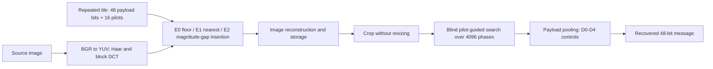

# SEPRCW - Stable Embedding and Pilot-Guided Recovery of Cropped Block Watermarks

We provide the implementation, evaluation records, dataset manifests, result
tables, and figures for the paper

> **Stable Embedding and Pilot-Guided Recovery of Cropped Block Watermarks**

Cropping disrupts bit-to-block correspondence, while image reconstruction can
change which coefficient is read even after correct alignment. We investigate
pilot-guided correspondence and coefficient-selection stability as distinct
factors. We evaluate learned decoder pooling as a control, without claiming
an additional advantage over strong simple decoders.

These research materials accompany a manuscript being prepared for IEEE Access
submission; no acceptance or publication is claimed.

[Project page](https://Michael-John-73.github.io/seprcw/) |
[Reproduction guide](docs/REPRODUCIBILITY.md) |
[Dataset guide](data/README.md) |
[License status](LICENSE_STATUS.md)



*Figure 1 - We compare insertion rules and decoder controls in Protocol E.
E2 constrains the selected coefficient's magnitude before reconstruction.
H-Q compares E1D0 and E2D0 at quality-selected strengths, with a separate blind
search for each method. The privileged insertion-index oracle is a separate
diagnostic and is not part of this blind-recovery pipeline.*

## 1. Protocol

| Evaluation | Question | Design |
|---|---|---|
| Protocol S | Does positional search recover cropped correspondence? | Fixed embedding; raster, fixed-phase tiles, blind search, and alignment oracle |
| Protocol E | Does stable insertion improve recovery, and does learned pooling add a gain? | Floor/nearest/constrained insertion; hard, soft, histogram, learned-reliability, and fitted-affine controls |
| Follow-up A | Which strengths meet the mean-quality comparison rule? | Quality-only selection on 200 validation sources |
| Diagnostic B | Does reading recorded insertion indices change recovery? | Same true alignment on the existing test panel; privileged, not blind |
| H-Q | Does the fixed mean-quality comparison retain a positive recovery difference? | 848 previously unused sources; fixed E1/E2 strengths 36/16 |

We analyze these panels separately rather than pooling their source counts or
inferential claims. We formulated H-Q after examining the original results and
fixed its new-source protocol before observing its outcomes.

**Method key:** E0 = floor insertion; E1 = nearest-lattice insertion;
E2 = magnitude-gap-constrained insertion. D0 = hard decoding;
D1 = soft pooling; D2 = histogram pooling; D3 = learned reliability;
D4 = fitted-affine control.

## 2. Evaluation settings

| Item | Setting |
|---|---|
| Payload and pilots | Repeated 8-by-8 tile: 48 payload bits and 16 pilot cells |
| Blind alignment | Search over 4096 phases without true crop coordinates |
| Protocol S test | 600 sources; primary retained areas 0.8/0.5 |
| Protocol E roles | Training 200, validation 200, calibration 600, test 600 |
| Original E insertion | Quantization step 36; constrained gap eta = 2 |
| E retained areas | 1.0, 0.8, 0.5, 0.25; primary areas 0.8/0.5 |
| H-Q sources | 424 photographs and 424 generated images |
| H-Q strengths | E1 step 36; E2 step 16; D0 decoding |
| H-Q mean-quality rule | Absolute mean PSNR gap <=0.25 dB and SSIM gap <=0.005 |
| H-Q uncertainty | 10000 source-paired, stratum-preserving bootstrap draws; weights 0.5/0.5; nominal two-sided 95% interval |

H-Q support requires both mean-quality tolerances and a positive lower endpoint
for the E2D0-minus-E1D0 recovery difference. The planned 3 percentage-point
interval half-width is a precision target, not the support criterion.

## 3. GPU setup

The original Protocol E production workflow uses CUDA for transforms, packed
phase search, pooling, training, and bootstrap computation.

| Item | Recorded Protocol E environment |
|---|---|
| GPU | NVIDIA RTX 4090, 24 GB |
| Python | 3.11.11 |
| PyTorch | 2.5.1+cu124 |
| CUDA | 12.4 |
| Numerical precision | FP32 features; AMP and TF32 disabled |
| Training | AdamW; learning rate 0.001; at most 30 epochs; early-stopping patience 5 |

Create and activate a separate environment, then install the dependencies and
CUDA-enabled PyTorch:

```bash
python -m venv .venv
# Activate .venv using your platform's command.
python -m pip install -r requirements.txt
python -m pip install torch==2.5.1 --index-url https://download.pytorch.org/whl/cu124
```

The dependency list supports the public verification tools; the recorded
environment and configuration snapshots identify the original experiment.
Installing these packages alone does not recreate its data intake, fitted
models, calibration, or seals.

## 4. Images and released data

We release numerical measurements and source identifiers, not the image
collections. No image generator is trained by this project.

| Material | Source and restoration information |
|---|---|
| Photographs | Official COCO val2017; admitted filenames and byte hashes in the cohort manifest |
| Generated images | Official DiffusionDB; H-Q uses the pinned part-000002 archive |
| H-Q inputs | 848 source IDs, raw/prepared/pixel hashes, message assignments, and crop boxes |
| H-Q outputs | 3392 decoding rows and 1696 quality measurements |
| Original S/E | Stored calibration/test measurements, configurations, selections, and analyses |
| Follow-ups | Validation A quality/recovery records and diagnostic B oracle records |

Exact provider links, archive revision/checksum, preprocessing, and acquisition
instructions are in the [dataset guide](data/README.md). We excluded the 2000
historical working sources and nine ineligible or duplicate candidates before
H-Q recovery evaluation. These checks do not prove semantic or prompt-group
independence.

## 5. Repository layout and pipeline

```text
src/paper_a/                  Embedding, decoding, CUDA computation, training, audits
iscipt/                      Synchronization implementation
run_embedding.py             Protocol E stage entry point
run_sync.py                  Protocol S stage entry point
configs/embedding/           Protocol E configuration snapshots
configs/synchronization/     Protocol S configuration snapshots
tools/verify_release.py       File checksums and separate numerical recount
tools/make_figures.py         Figure from released H-Q measurements
tests/                       Regression and release-interface checks
data/protocol_s/              Original synchronization evidence
data/protocol_e/              Original embedding/decoding evidence
data/followup/                Validation A and diagnostic B evidence
data/hq/                     Fixed-cohort confirmation records and provenance
data/release_manifest.json    Public-file checksums and original evidence hashes
docs/                        Project page and detailed reproduction guide
```

| Stage | Entry point or command | Scope |
|---|---|---|
| Environment and input checks | `run_embedding.py --config CONFIG preflight` | CUDA availability, inputs, and configuration |
| Projection verification | `run_embedding.py --config CONFIG math-check` | Finite-lattice mathematical checks |
| Preparation and development | `prepare`, `cache`, `pilot`, `develop`, `controls-audit` | Role-assigned sources, models, and validation |
| Detector fitting and design | `detector-fit`, `power`, `lock-design`, `freeze` | Training-role fits and recorded design |
| Calibration and evaluation | `calibrate`, `evaluate --split test`, `analyze --split test` | Frozen thresholds and test measurements |
| Recount and audit | `recount --split test`, `audit` | Separate checks of stored results and integrity |

The table identifies stages, not an unconditional one-command reproduction.
Stage prerequisites and recorded role assignments remain necessary.

### Starting a fresh GPU workflow

Copy `configs/embedding/runpod.template.json` to a new local configuration.
Set its `paths.dataset_root`, `paths.input_csv`, and a **new** `paths.run_root`
for the original image intake and role assignments. Keep `training.device`
set to `cuda`. Then run the initial checks:

```bash
python -u run_embedding.py --config PATH_TO_NEW_CONFIG.json preflight
python -u run_embedding.py --config PATH_TO_NEW_CONFIG.json math-check
```

The production runner requires an available CUDA device and reports START/END
events and stage progress. These checks do not rerun training or certify a new
experiment. We preserve historical thresholds, model selections, and seals
with their original runs rather than transferring them to changed experiments.
The [reproduction guide](docs/REPRODUCIBILITY.md) describes workflow boundaries.

### Verify the released measurements

```bash
python tools/verify_release.py
python -m unittest discover -s tests -p "test_*.py" -v
python tools/make_figures.py
```

These commands check file digests, recalculate recovery and quality summaries
from released records, and rebuild the result figure. They do not execute a
new image experiment or repeat the GPU training trajectories. The detailed
guide retains the separate fixed-cohort H-Q reproduction procedure.

## 6. Results

| Evaluation | Result | Interpretation |
|---|---|---|
| S, test 600 | Blind search 56.9167% vs raster 0% | H1/H2 PASS; H3 INCONCLUSIVE |
| E, test 600 | E2D0 1191/1200; E2D3 1184/1200 | No additional learned-decoder advantage; original formal E verdicts WITHHELD |
| A, validation 200 | E1 step 36: 214/400; E2 step 16: 396/400 | Development, not independent confirmation |
| B, existing test 600 | E1 oracle max/written index: 728/1196 of 1200 | Same true alignment; not blind recovery |
| H-Q, new 848 | E1D0 957/1696; E2D0 1686/1696 | Fixed mean-quality point, same dataset collections |


*Figure 2 - We report blind recovery at the fixed mean-quality comparison point
and the source-paired E2D0-minus-E1D0 contrast. The nominal 95% interval belongs
to the contrast, not to the individual recovery bars.*

| H-Q method | Strength | Mean PSNR (dB) | Mean SSIM | Blind exact recovery |
|---|---|---|---|---|
| E1D0 | 36 | 38.975026 | 0.973238781 | 957/1696 (56.426887%) |
| E2D0 | 16 | 39.102813 | 0.973645160 | 1686/1696 (99.410377%) |

We fixed these strengths using validation quality alone, before measuring
recovery at the selected pair. In the [released H-Q analysis](data/hq/analysis.json),
the source-paired difference is **42.983491 percentage points**, with nominal
stratified 95% interval **[39.976415, 45.990566] pp**. Mean PSNR and SSIM gaps
are **0.127787 dB** and **0.000406378**, within the fixed tolerances.

The actual interval half-width is 3.007075 pp, slightly above the 3 pp planning
target. We did not extend the sample after observing outcomes.

## 7. Interpretation and limits

- We found support for insertion stability at the specified mean-quality
  point, not perceptual equivalence or superiority at all strengths.
- We did not establish an incremental learned-decoder advantage.
- The original S/E panels are not fresh external validation. H-Q uses
  previously unused sources from the same dataset collections, not a new
  generator or external domain.
- We withhold original E formal verdicts because we did not adopt positive
  practical margins.
- Zero constrained-method false accepts in the original E panel give an
  adjusted upper bound of 1.085908%, **not** certification at 1%. H-Q adds no
  acceptance calibration or false-acceptance guarantee.

## 8. Provenance and rights

We replaced local machine paths with portable references in public JSON exports.
The [release manifest](data/release_manifest.json) records public-file hashes
separately from original frozen-evidence hashes. Original lock hashes do not
authenticate transformed exports byte-for-byte. Git line-ending conversion is
disabled to preserve released file bytes across platforms.

We do not redistribute original or marked images, prompts, private credentials,
or IEEE template assets. COCO image rights are not covered by a blanket
annotation license; image access follows the original providers' terms.

No public reuse license has been selected for the original contributions.
See [LICENSE_STATUS.md](LICENSE_STATUS.md) and
[THIRD_PARTY_NOTICES.md](THIRD_PARTY_NOTICES.md).
