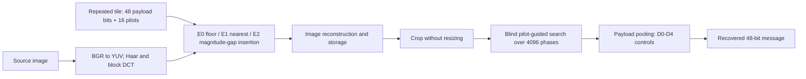
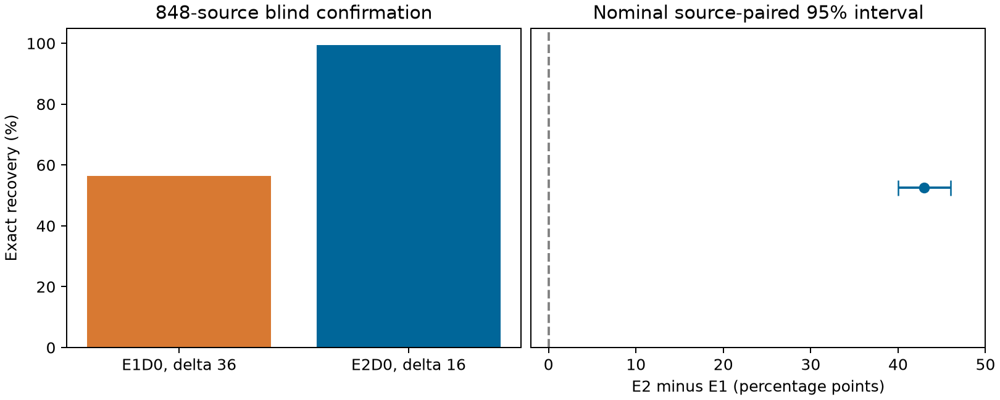

# SEPRCW

**Stable Embedding and Pilot-Guided Recovery of Cropped Block Watermarks**

Hyeong-Gyun Yun and Hye-Young Kim (corresponding author).

Research implementation and reproducibility materials being prepared for
IEEE Access submission. This is **not** a claim of acceptance or publication.
No manuscript DOI has been assigned.

[Project page](https://Michael-John-73.github.io/seprcw/) |
[Reproduction guide](docs/REPRODUCIBILITY.md) |
[Dataset guide](data/README.md) |
[License status](LICENSE_STATUS.md)

## What the paper tests

Cropping changes bit-to-block correspondence, and image reconstruction can
change which coefficient is selected after alignment. We separate
pilot-guided positional recovery, constrained embedding stability, and decoder
pooling. We tested the learned decoder as an alternative and did not establish
an improvement over strong simple controls.

1. **Protocol S:** raster, fixed-phase tiles, blind search, and alignment oracle.
2. **Protocol E:** floor/nearest/constrained insertion with hard, soft, histogram,
   learned-reliability, and fitted-affine controls.
3. **Follow-up A:** strength selection using validation quality alone.
4. **Diagnostic B:** same-alignment, privileged insertion-index diagnosis.
5. **H-Q:** fixed-strength blind confirmation on 848 previously unused sources.

We analyze these cohorts and estimands separately rather than pooling them.

## Embedding and blind-recovery workflow



**Figure 1.** We compare insertion rules and decoder controls in Protocol E.
E2 constrains the selected coefficient's magnitude relative to competing
coefficients before reconstruction. In H-Q, we compare only E1D0 and E2D0 at
the quality-selected strengths, with a separate blind search for each method.
Protocol S separately compares positional-recovery strategies. The diagram
does not depict the privileged insertion-index oracle used in diagnostic B.

**Method key:** E0 = floor insertion; E1 = nearest-lattice insertion;
E2 = magnitude-gap-constrained insertion. D0 = hard decoding;
D1 = soft pooling; D2 = histogram pooling; D3 = learned reliability;
D4 = fitted-affine control.

## Paper-aligned results

| Evaluation | Result | Interpretation |
|---|---|---|
| S, test 600 | Blind search 56.9167% vs raster 0% | H1/H2 PASS; H3 INCONCLUSIVE |
| E, test 600 | E2D0 1191/1200; E2D3 1184/1200 | No additional learned-decoder advantage; original formal E verdicts WITHHELD |
| A, validation 200 | E1 delta 36: 214/400; E2 delta 16: 396/400 | Development, not independent confirmation |
| B, existing test 600 | E1 oracle max/written index: 728/1196 of 1200 | Same true alignment; not blind recovery |
| H-Q, new 848 | E1D0 957/1696; E2D0 1686/1696 | Fixed mean-quality point, same dataset collections |

H-Q ERs are **56.426887% / 99.410377%**. The source-paired difference is
**42.983491 percentage points**, with nominal stratified 95% bootstrap interval
**[39.976415, 45.990566] pp**. Mean PSNR gap is **0.127787 dB**, and SSIM gap
is **0.000406378**, within the prespecified 0.25/0.005 tolerances.



**Figure 2.** We report blind recovery at the fixed mean-quality comparison
point and the source-paired E2D0-minus-E1D0 contrast. The interval belongs to
that contrast, not to the individual recovery bars.

| H-Q method | Strength | Mean PSNR (dB) | Mean SSIM | Blind exact recovery |
|---|---|---|---|---|
| E1D0 | 36 | 38.975026 | 0.973238781 | 957/1696 (56.426887%) |
| E2D0 | 16 | 39.102813 | 0.973645160 | 1686/1696 (99.410377%) |

We fixed these strengths using validation quality alone, before measuring
recovery at the selected pair. We report the H-Q quality and recovery values
from [the released analysis](data/hq/analysis.json), separately from the
original equal-step E comparison. Mean-quality matching does not imply
per-image or perceptual equivalence.

The actual interval half-width is 3.007075 pp, slightly above the 3 pp planning
target. We did not extend the sample after observing outcomes. We found support
for one specified mean-quality point, not perceptual equivalence, all-strength
superiority, unseen-generator generalization, or a new false-acceptance claim.
Zero constrained-method false accepts in the original E panel yield an adjusted
upper bound of 1.085908%, **not** certification at 1%.

## Repository layout

```text
src/paper_a/                  Frozen H-Q engine; original E implementation
iscipt/                      Original synchronization engine
tools/hq_independent_cpu.py   Frozen CPU experiment runner
tools/hq_cpu_statistics.py    Source-paired statistics and decision rule
tools/verify_release.py       File checksums and independent bit/quality recount
tools/reproduce_hq.py         Official image acquisition, preparation, blind rerun
tools/make_figures.py         Figure from released H-Q measurements
tests/                       H-Q regression and release interface checks
data/hq/                     848-source manifest, bits, quality, analysis, locks
data/protocol_s/              Original S summaries and stored measurements
data/protocol_e/              Original E contrasts, calibration/test measurements
data/followup/                Validation A and oracle B evidence
data/release_manifest.json    Public file checksums and source provenance
configs/                     Original experiment configurations
docs/                        Project page and reproduction instructions
run_embedding.py             Original E stage entry point (CUDA workflow)
run_sync.py                  Original S stage entry point
```

For the public JSON files, we replaced our machine paths with portable paths.
We recorded both original evidence hashes and public-file hashes in the release
manifest. Original lock hashes refer to the frozen source evidence, not to
the path-normalized public exports.
Git line-ending conversion is disabled for this repository's files so that
checksums and frozen source bytes remain identical across platforms.

## Quick start: verify results without downloading images

The original CPU run used Python 3.13.3. Work in a separate virtual environment.
We recorded the public-wrapper validation environment separately in
`data/tested_environment.json` and the original run's environment in
`data/hq/design.json`.

```bash
python -m venv .venv
# Activate .venv using your platform's command.
python -m pip install -r requirements.txt
python tools/verify_release.py
python -m unittest discover -s tests -p "test_*.py" -v
python tools/make_figures.py
```

This recounts released 48-bit predictions, crop/method pairing, source-stratified
uncertainty, mean quality, and H-Q's decision. It does **not** re-embed images.
We froze the numerical implementation and report environment differences
without tuning the implementation to force agreement.

We also tested the public release wrapper on the full 848-source
cohort: 3392 blind decodes and 1696 quality measurements matched the reference,
including all predicted bits, phases, coverage, crop boxes, marked PNG hashes,
and quality. Fourteen regression/interface tests passed. We report both the
wrapper-validation and original experiment environments rather than claiming
that the rerun used identical package versions.

## Full H-Q CPU reproduction from original images

Install the CPU PyTorch build separately; the recorded run used
`torch==2.12.0+cpu`. No GPU or image generator is needed.

```bash
python -m pip install torch==2.12.0+cpu --index-url https://download.pytorch.org/whl/cpu
python tools/reproduce_hq.py prepare --download
python tools/reproduce_hq.py run --workers 4
```

`--download` explicitly acquires the official COCO val2017 archive and the pinned
DiffusionDB part-000002 archive. Image bytes and prepared pixels are verified
against the admitted-source manifest. Download sizes are much larger than the
released numerical records.

Alternatively, use files already obtained from the original providers:

```bash
python tools/reproduce_hq.py prepare --real-dir PATH_TO_COCO_VAL2017 --ai-dir PATH_TO_DIFFUSIONDB_PART2
python tools/reproduce_hq.py run --workers 4
```

Use `--limit 4` only for a diagnostic smoke run; it is not the 848-source
confirmation. The full command compares all predicted bits, phases, coverage,
crop boxes, marked PNG hashes, and quality with the released run. Existing
output directories are never overwritten. See the [full guide](docs/REPRODUCIBILITY.md)
for original S/E workflow boundaries and interpretation.

## Data access and rights

We upload numerical results, cohort identifiers, hash inventories, configurations,
and code. We **do not** upload original images, marked images, prompts, private
keys, RunPod credentials, or IEEE template fonts/classes. COCO image rights are
not covered by a blanket annotation license. Obtain images from the official
providers and follow their terms. Dataset identifiers and exact restoration
steps are in [data/README.md](data/README.md).

No open-source license has been selected for the authors' original contributions.
See [LICENSE_STATUS.md](LICENSE_STATUS.md) and the retained upstream notice.

## Citation

We provide the following citation for the manuscript in preparation. No final
IEEE Access volume, page range, acceptance year, or DOI is available. The
repository commit identifies the version used for reproduction.

```bibtex
@misc{yun_seprcw,
  author = {Yun, Hyeong-Gyun and Kim, Hye-Young},
  title = {Stable Embedding and Pilot-Guided Recovery of Cropped Block Watermarks},
  howpublished = {\url{https://github.com/Michael-John-73/seprcw}},
  note = {Manuscript in preparation for IEEE Access; identify the repository commit}
}
```
