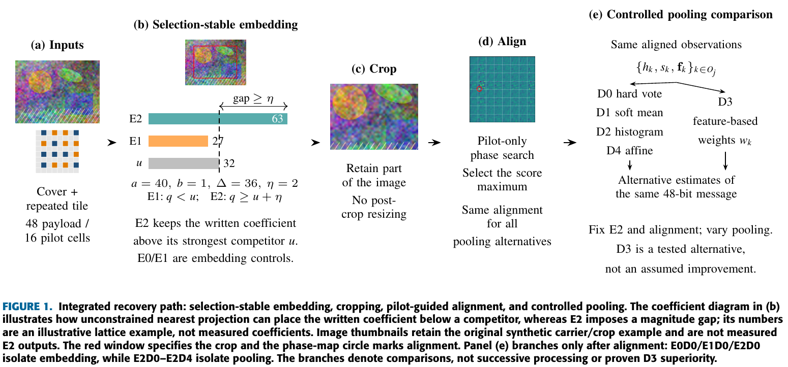
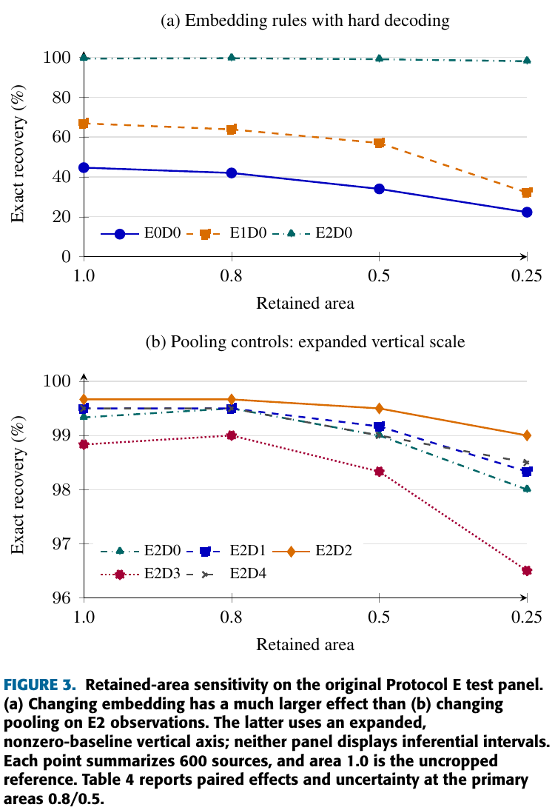

# SEPRCW - Stable Embedding and Pilot-Guided Recovery of Cropped Block Watermarks

Cropping disrupts bit-to-block correspondence, while image reconstruction can
change which coefficient is read even after correct alignment. We investigate
these two failure mechanisms separately: **pilot-guided correspondence** restores
alignment, and **selection-stable embedding** preserves the coefficient used to
recover each bit.

We provide the implementation, evaluation records, dataset manifests, tables,
and figures for the paper

> **Stable Embedding and Pilot-Guided Recovery of Cropped Block Watermarks**

We evaluate learned decoder pooling as a control, without claiming an additional
advantage over strong simple decoders. These materials accompany a manuscript
being prepared for IEEE Access submission; no acceptance or publication is claimed.



*Paper Figure 1 - Integrated recovery path, reproduced directly from the
manuscript. Panels (a)-(e) show the input tile, selection-stable embedding,
cropping, pilot-guided alignment, and controlled pooling comparisons.
The coefficient example and synthetic thumbnails are illustrative, not
measured E2 outputs. The branches represent comparisons, not successive
processing or proven D3 superiority.*

## 1. Research question and method

We distinguish a positional failure from an observation failure. A crop can
change the origin and width of the block grid, assigning observations to the
wrong message bits. Even with correct correspondence, reconstruction and storage
can change the largest-magnitude coefficient selected within a block.

| Component | What we do | What the comparison isolates |
|---|---|---|
| Repeated payload/pilot tile | Repeat 48 payload bits and 16 pilot cells in an 8-by-8 tile | Shared carrier for correspondence and recovery |
| Pilot-guided alignment | Search 4096 phases using pilot observations, without true crop coordinates | Positional recovery after cropping |
| Selection-stable embedding | Place the written coefficient above its strongest competitor with a magnitude gap | Coefficient-selection stability |
| Controlled pooling | Hold E2 and alignment fixed while comparing D0-D4 | Any incremental decoder-pooling benefit |

**Embedding rules:** E0 = floor insertion; E1 = nearest-lattice insertion;
E2 = magnitude-gap-constrained insertion.

**Decoding rules:** D0 = hard decoding; D1 = soft pooling; D2 = histogram pooling;
D3 = learned reliability; D4 = fitted-affine control.

We do not treat successful alignment as proof of exact payload recovery, or
successful acceptance as proof that all recovered bits are correct.

## 2. Evaluation design

| Evaluation | Research question | Sources and comparison |
|---|---|---|
| Protocol S | Does positional search recover cropped correspondence? | Test 600; fixed embedding; raster, fixed-phase tiles, blind search, and alignment oracle |
| Protocol E | Does stable insertion improve recovery, and does learned pooling add a gain? | Training 200, validation 200, calibration 600, test 600; insertion and decoder controls |
| Follow-up A | Which strengths meet the mean-quality comparison rule? | Quality-only selection on 200 validation sources |
| Diagnostic B | Does reading recorded insertion indices change recovery? | Existing test 600; same true alignment; privileged, not blind |
| H-Q | Does the fixed mean-quality comparison retain a positive recovery difference? | 848 previously unused sources; fixed E1/E2 strengths 36/16 |

We analyze these panels separately rather than pooling source counts or
inferential claims. We formulated H-Q after examining the original results and
fixed its new-source protocol before observing its outcomes.

The original E comparison uses step 36 and a constrained gap of 2. Its retained
areas are 1.0, 0.8, 0.5, and 0.25, with 0.8/0.5 primary. In H-Q, we compare
E1D0 and E2D0 with a separate blind search for each method at areas 0.8/0.5.

## 3. Synchronization and embedding results

| Evaluation | Result | Interpretation |
|---|---|---|
| S, test 600 | Blind search 56.9167% vs raster 0% | H1/H2 PASS; H3 INCONCLUSIVE |
| E, test 600 | E2D0 1191/1200 (99.25%); E2D3 1184/1200 (98.6667%) | No additional learned-decoder advantage; original formal E verdicts WITHHELD |
| A, validation 200 | E1 step 36: 214/400; E2 step 16: 396/400 | Development, not independent confirmation |
| B, existing test 600 | E1 oracle max/written index: 728/1196 of 1200 | Same true alignment; not blind recovery |

In Protocol E, we reduced the mean selected-coefficient change rate from
**46.789209% to 0.037376%**. The strong hard-decoding result and the absence of an
incremental D3 advantage support a scoped embedding-stability interpretation,
not general learned-decoder superiority. We also observed a distortion cost
at equal quantization steps, motivating the separate quality-controlled comparison.



*Paper Figure 3 - Retained-area sensitivity, reproduced directly from the
manuscript. Panel (a) compares embedding rules with D0; panel (b) compares
pooling controls on E2 observations using an expanded, nonzero-baseline vertical
axis. These are original Protocol E results on 600 sources, not H-Q measurements;
neither panel shows inferential intervals.*

## 4. Quality-controlled confirmation

We selected E1/E2 strengths of 36/16 using validation quality alone, before
measuring recovery at that pair. We then evaluated the fixed comparison on
**848 previously unused sources: 424 photographs and 424 generated images**.
The existing H-Q confirmation was performed on **CPU**; its original code,
results, and recorded environment remain unchanged.

| H-Q method | Strength | Mean PSNR (dB) | Mean SSIM | Blind exact recovery |
|---|---|---|---|---|
| E1D0 | 36 | 38.975026 | 0.973238781 | 957/1696 (56.426887%) |
| E2D0 | 16 | 39.102813 | 0.973645160 | 1686/1696 (99.410377%) |

We obtained a source-paired recovery difference of **42.983491 percentage
points**, with a nominal stratified 95% interval of **[39.976415, 45.990566] pp**.
Mean PSNR and SSIM gaps were **0.127787 dB** and **0.000406378**, within the fixed
0.25 dB / 0.005 tolerances.

We found support for H-Q because both mean-quality criteria were met and the
recovery-difference lower endpoint exceeded zero. We used 10000 source-paired,
stratum-preserving bootstrap draws with weights 0.5/0.5. We do not claim exact
finite-sample coverage. The actual interval half-width was 3.007075 pp, slightly
above the 3 pp planning target; we did not extend the sample after observing
outcomes.

The [released H-Q analysis](data/hq/analysis.json) retains the full numerical
results. A crop/method row is not an independent source.

## 5. Interpretation and limits

- We found support for insertion stability at the specified mean-quality
  point, not perceptual equivalence or superiority at all strengths.
- We did not establish an incremental learned-decoder advantage.
- The original S/E panels are not fresh external validation. H-Q uses
  previously unused sources from the same dataset collections, not a new
  generator or external domain.
- The same-alignment insertion-index oracle helps diagnose selection
  instability but does not replace the original blind-recovery results.
- We withhold original E formal verdicts because we did not adopt positive
  practical margins.
- Zero constrained-method false accepts in the original E panel give an
  adjusted upper bound of 1.085908%, **not** certification at 1%. H-Q adds no
  acceptance calibration or false-acceptance guarantee.

## 6. Research data

We release numerical measurements and source identifiers, not the image
collections. No image generator is trained by this project.

| Material | Released evidence |
|---|---|
| Photographs and generated images | Official COCO val2017 and DiffusionDB identifiers; H-Q uses the pinned DiffusionDB part-000002 archive |
| H-Q inputs | 848 source IDs, raw/prepared/pixel hashes, message assignments, and crop boxes |
| H-Q outputs | 3392 decoding rows and 1696 quality measurements |
| Original S/E | Stored calibration/test measurements, configurations, selections, and analyses |
| Follow-ups | Validation A quality/recovery records and diagnostic B oracle records |

We excluded the 2000 historical working sources and nine ineligible or duplicate
candidates before H-Q recovery evaluation. These checks do not prove semantic
or prompt-group independence. Provider links, archive revision/checksum, and
acquisition instructions are in the [dataset guide](data/README.md).

## 7. Reproducibility resources

The paper explanation and findings are presented above. Installation, workflow
stages, and verification commands are supporting materials:

- [Reproduction guide](docs/REPRODUCIBILITY.md): detailed workflow boundaries
  and the existing H-Q CPU reproduction procedure.
- [Dataset guide](data/README.md): official image acquisition and exact hashes.
- [Release manifest](data/release_manifest.json): public-file checksums and
  original evidence hashes.

<details>
<summary>GPU environment and installation for original Protocol E</summary>

The original E production workflow uses CUDA for transforms, packed phase
search, pooling, training, and bootstrap computation. This environment does
not describe the existing H-Q CPU experiment.

| Item | Recorded Protocol E environment |
|---|---|
| GPU | NVIDIA RTX 4090, 24 GB |
| Python | 3.11.11 |
| PyTorch | 2.5.1+cu124 |
| CUDA | 12.4 |
| Numerical precision | FP32 features; AMP and TF32 disabled |
| Training | AdamW; learning rate 0.001; at most 30 epochs; early-stopping patience 5 |

Create and activate a separate environment, then install:

```bash
python -m venv .venv
# Activate .venv using your platform's command.
python -m pip install -r requirements.txt
python -m pip install torch==2.5.1 --index-url https://download.pytorch.org/whl/cu124
```

The dependency list supports the public verification tools; the recorded
environment and configuration snapshots identify the original experiment.
Installing these packages alone does not recreate its data intake, fitted
models, calibration, or seals.

</details>

<details>
<summary>Repository layout and original GPU workflow</summary>

```text
src/paper_a/                  Embedding, decoding, CUDA computation, training, audits
iscipt/                      Synchronization implementation
run_embedding.py             Protocol E stage entry point
run_sync.py                  Protocol S stage entry point
configs/embedding/           Protocol E configuration snapshots
configs/synchronization/     Protocol S configuration snapshots
tools/verify_release.py       File checksums and separate numerical recount
tools/make_figures.py         Figure from released H-Q measurements
tests/                       Regression and release-interface checks
data/protocol_s/              Original synchronization evidence
data/protocol_e/              Original embedding/decoding evidence
data/followup/                Validation A and diagnostic B evidence
data/hq/                     Fixed-cohort confirmation records and provenance
docs/                        Project page source and detailed reproduction guide
```

| Stage | Entry point or command | Scope |
|---|---|---|
| Environment and input checks | `run_embedding.py --config CONFIG preflight` | CUDA availability, inputs, and configuration |
| Projection verification | `run_embedding.py --config CONFIG math-check` | Finite-lattice mathematical checks |
| Preparation and development | `prepare`, `cache`, `pilot`, `develop`, `controls-audit` | Role-assigned sources, models, and validation |
| Detector fitting and design | `detector-fit`, `power`, `lock-design`, `freeze` | Training-role fits and recorded design |
| Calibration and evaluation | `calibrate`, `evaluate --split test`, `analyze --split test` | Frozen thresholds and test measurements |
| Recount and audit | `recount --split test`, `audit` | Separate checks of stored results and integrity |

This table identifies stages, not an unconditional one-command reproduction.
Stage prerequisites and recorded role assignments remain necessary.

For a fresh workflow, copy `configs/embedding/runpod.template.json` to a new
local configuration. Set `paths.dataset_root`, `paths.input_csv`, and a **new**
`paths.run_root` for the original intake and role assignments. Keep
`training.device` set to `cuda`. Run the initial checks:

```bash
python -u run_embedding.py --config PATH_TO_NEW_CONFIG.json preflight
python -u run_embedding.py --config PATH_TO_NEW_CONFIG.json math-check
```

The production runner requires an available CUDA device and reports START/END
events and stage progress. These checks do not rerun training or certify a new
experiment. We preserve historical thresholds, model selections, and seals
with their original runs rather than transferring them to changed experiments.

</details>

<details>
<summary>Verify the released measurements</summary>

```bash
python tools/verify_release.py
python -m unittest discover -s tests -p "test_*.py" -v
python tools/make_figures.py
```

These commands check file digests, recalculate recovery and quality summaries
from released records, and generate a descriptive H-Q figure. That generated
figure is separate from the manuscript Figures 1 and 3 displayed above.
The commands do not execute a new image experiment or repeat the GPU training
trajectories. The reproduction guide retains the separate fixed-cohort H-Q
procedure.

</details>

## 8. Provenance and rights

We replaced local machine paths with portable references in public JSON exports.
The release manifest records public-file hashes separately from original
frozen-evidence hashes. Original lock hashes do not authenticate transformed
exports byte-for-byte. Git line-ending conversion is disabled to preserve
released file bytes across platforms.

We do not redistribute original or marked images, prompts, private credentials,
or IEEE template assets. COCO image rights are not covered by a blanket
annotation license; image access follows the original providers' terms.

No public reuse license has been selected for the original contributions.
See [LICENSE_STATUS.md](LICENSE_STATUS.md) and
[THIRD_PARTY_NOTICES.md](THIRD_PARTY_NOTICES.md).
